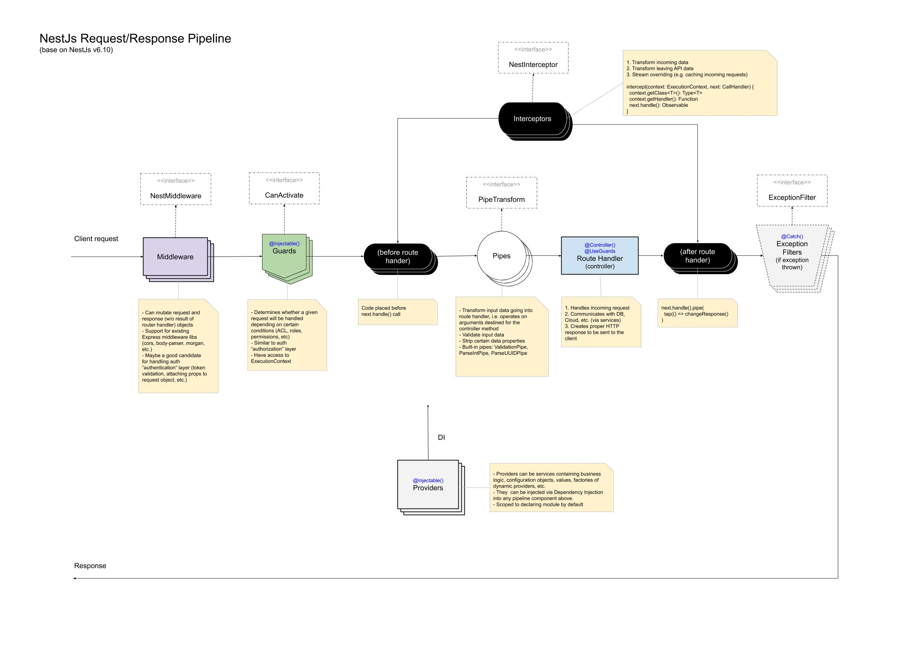

# Arquitectura del Sistema: Estrategia y Pipeline

Este documento describe la arquitectura de Parkit, desde las estrategias fundamentales de aislamiento y datos hasta el flujo detallado de las peticiones HTTP.

## 1. Aislamiento Multi-tenancy
El sistema utiliza un enfoque de **Base de Datos Única y Esquema Compartido**. El aislamiento se logra mediante dos capas de defensa:

- **Capa de Base de Datos (RLS)**: Las políticas de Row-Level Security en PostgreSQL protegen los datos cuando se accede directamente a través del cliente de Supabase (frontend).
- **Capa de Aplicación (Prisma Extensions)**: El backend utiliza la `service_role` (que omite RLS por diseño de Supabase) pero aplica el aislamiento mediante una extensión personalizada de Prisma que inyecta automáticamente el `tenantId` en todas las consultas mediante `getTenantClient()`.

## 2. Estrategia de DTOs
Para mantener un equilibrio entre velocidad de desarrollo y control estricto:

- **Auto-generados**: Las operaciones CRUD estándar utilizan DTOs generados automáticamente por ZenStack/Prisma (ubicados en `src/generated/nestjs-dto/`) para mantener el principio DRY.
- **Manuales**: La lógica de negocio compleja, contratos de autenticación o integraciones externas (ej. webhooks de hardware) utilizan DTOs manuales con `class-validator` para un control total del contrato.

---

## 3. Pipeline de Peticiones (Request Lifecycle)

A continuación se detalla cómo fluye una petición a través del sistema aplicando la multi-tenencia:

### A. Guards (Autorización)
- **TenantMembershipGuard**: Es el primer punto de control. Verifica que el usuario del JWT tenga una relación válida en la tabla `user_memberships` para el `tenantId` solicitado en la URL. Si no existe la relación, bloquea la petición (403 Forbidden).

### B. Interceptors (Contexto)
- **TenantInterceptor**: Una vez autorizado, este interceptor captura el `tenantId` y lo inicializa en un `AsyncLocalStorage`. Esto crea un "túnel" de contexto que dura toda la vida de la petición.

### C. Services & Prisma (Aislamiento Automático)
- El servicio llama a `this.prisma.getTenantClient()`.
- Esta llamada recupera el ID del "túnel" de contexto y devuelve una instancia de Prisma que inyecta el filtro `WHERE tenant_id = ...` en cada operación de base de datos de forma transparente.

### D. Exception Filters (Formato de Error)
- Cualquier fallo es capturado por los filtros globales para devolver una respuesta estructurada bajo el estándar **RFC 7807**.
