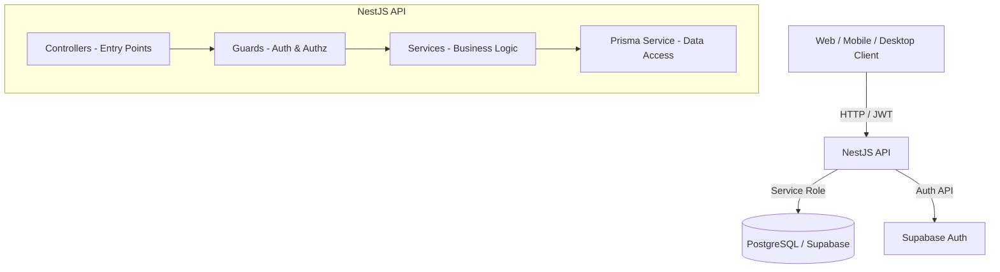

# System Architecture: Parkit Backend

This document provides a high-level overview of the backend architecture for the Parkit project.

## Tech Stack

- **Framework**: [NestJS](https://nestjs.com/) (Node.js)
- **Language**: TypeScript
- **Database**: PostgreSQL (hosted via [Supabase](https://supabase.com/))
- **ORM**: [Prisma](https://www.prisma.io/)
- **Authentication**: Supabase Auth (Wrappers in NestJS)
- **Documentation**: Swagger (OpenAPI 3.0)

## Architecture Overview

The system follows a modular architecture provided by NestJS, organized by domain features.

## Key Design Patterns

### 1. Multi-tenancy Isolation
The system uses a **Single Database, Shared Schema** approach. Isolation is achieved through two layers:
- **Database Layer (RLS)**: Row-Level Security policies in PostgreSQL protect data when accessed directly via the Supabase client (frontend).
- **Application Layer (Prisma Extensions)**: The backend uses the `service_role` (bypassing RLS) but enforces isolation via a custom Prisma extension (`prismaForTenant`) that automatically injects `tenantId` into all queries.

### 2. DTO Strategy
- **Auto-generated**: Standard CRUD operations use DTOs generated by ZenStack/Prisma to maintain DRY principles.
- **Manual**: Complex business logic or external integrations (e.g., webhooks) use manual DTOs with `class-validator`.

### 3. Error Handling
The API follows [RFC 7807 (Problem Details for HTTP APIs)](https://datatracker.ietf.org/doc/html/rfc7807) to provide consistent, machine-readable error responses.

## Module Structure

Each feature (e.g., `entries`, `vehicles`) is encapsulated in a NestJS module containing:
- `*.controller.ts`: Defines routes and handle HTTP requests.
- `*.service.ts`: Contains business logic.
- `*.module.ts`: Wires everything together.
- `*.spec.ts`: Unit tests for the module.
